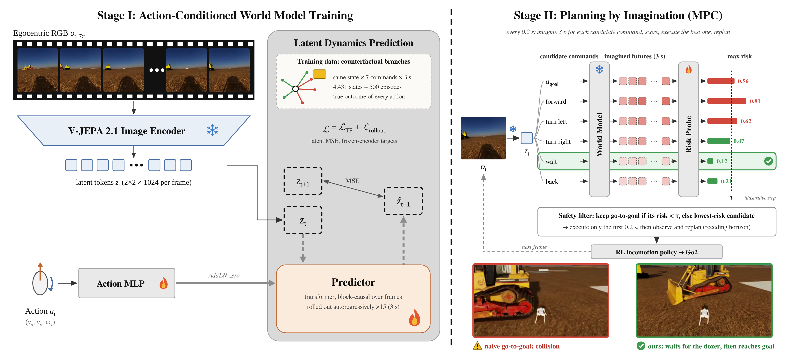

# World-nav

This is a GIST research-course project in collaboration with Florigen Robotics.

We train a latent world model for predictive collision avoidance on a Unitree Go2 quadruped, on simulated construction sites (Isaac Lab), with a frozen V-JEPA 2.1 encoder.

> **Work in progress.** The training pipeline, the closed-loop evaluation runner and the first closed-loop results are online. The planner code and the final results will be added soon.

## Demo: world model shield vs naive

Same scene and seed for both (seed 90012, dozer). The robot starts at **S** and must reach the goal **G**.

- **Top: naive baseline.** It goes straight to the goal and hits the dozer.
- **Bottom: world model shield.** It waits for the dozer, then reaches the goal.

*Each row: chase camera, Go2 front camera (the model's input), top view. Full-quality video: [`media/seed12-wmvsnaive.mp4`](media/seed12-wmvsnaive.mp4).*

## Method

**Stage I.** A frozen V-JEPA 2.1 encoder turns frames into latents. An action-conditioned predictor learns to roll them out under velocity commands. It is trained on the main trajectories and on counterfactual branches (the same state replayed with 7 commands for 3 s).

**Stage II.** Every 0.2 s, the world model imagines 3 s for each candidate command and a risk probe scores the imagined futures. The safety filter keeps go-to-goal unless its risk exceeds τ, and otherwise takes the lowest-risk candidate.

## Repository

- [`go2_wm_vjepa21.ipynb`](go2_wm_vjepa21.ipynb): training and offline evaluation of the world model and the risk probe (Colab, A100; outputs cleared for now).
- [`closed_loop/`](closed_loop/): closed-loop evaluation in Isaac Lab. It plugs into the simulation project, which is not in this repository yet.
- [`results/`](results/): first closed-loop tests (20 seeds each). These results are preliminary.
- [`docs/dataset.md`](docs/dataset.md): dataset settings. The dataset is private for now.

**Coming soon:** the planner code and the final results.

## Acknowledgements

- [V-JEPA 2](https://github.com/facebookresearch/vjepa2) (Meta FAIR): frozen video encoder (V-JEPA 2.1 ViT-L/16, 384 px).
- The AdaLN-zero predictor block is adapted from [Orbit-Planner](https://github.com/ZhijianLi2003/Orbit_Planner) (Apache-2.0), itself based on LeWM.
