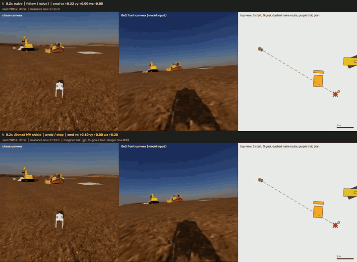

# world-nav

Latent world model for predictive collision avoidance on a Unitree Go2 quadruped, trained on simulated construction sites (Isaac Lab) with a frozen V-JEPA 2.1 encoder. Training and offline evaluation are in [`go2_wm_vjepa21.ipynb`](go2_wm_vjepa21.ipynb).

## Demo: world model shield vs naive

Here is an example of the **world model shield** compared with a **naive** controller on the same scene (seed 90012, dozer). Both robots start at **S** and must reach the goal **G**.

- **Top: naive.** It follows the straight route to the goal (dashed line in the top view).
- **Bottom: WM shield.** At each step the world model imagines 3 s of the future for the go-to-goal command and 5 primitives. The shield keeps go-to-goal unless its imagined risk is too high, and then switches to the safest candidate.

Each row shows the chase camera, the Go2 front camera (the model's input) and a top view with the trail and the plan. The header shows the current command, the clearance to the machine, and for the shield the imagined risk and the current danger.

*Full-quality video: [`media/seed12-wmvsnaive.mp4`](media/seed12-wmvsnaive.mp4).*

## Method

*Action-conditioned latent world model. A frozen V-JEPA 2.1 encoder maps frames to latents; a trained AdaLN predictor rolls them out under velocity commands; a trained risk probe scores the imagined futures for the planner.*

*Closed loop at 5 Hz: the world model imagines 3 s for the go-to-goal command and 5 primitives; the safety filter keeps go-to-goal unless its imagined risk exceeds τ.*
