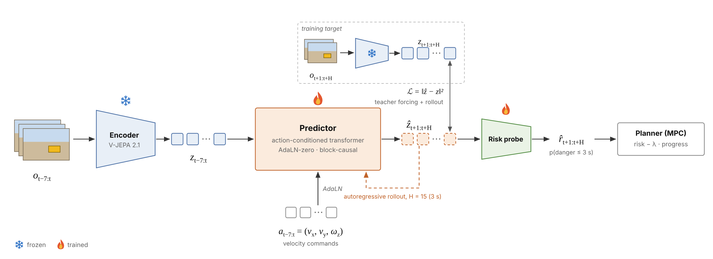
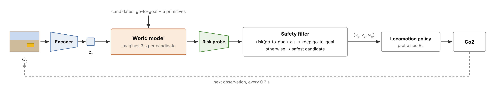

# World-nav

This a GIST research-course project in collaboration with Florigen robotics !

We tried a latent world model for predictive collision avoidance on a Unitree Go2 quadruped, trained on simulated construction sites (Isaac Lab) with a frozen V-JEPA 2.1 encoder.

> **Work in progress: results and the closed-loop planner will be added soon.**
> This repository currently contains the training and offline-evaluation skeleton of the world model. The quantitative results, the closed-loop planner used in the demo below, and the remaining code will be released in the next updates.

## Demo: world model shield vs naive

Here is an example of the **world model shield** compared with a **naive** controller on the same scene (seed 90012, dozer). Both robots start at **S** and must reach the goal **G**.

- **Top: naive.** It follows the straight route to the goal (dashed line in the top view).
- **Bottom: WM shield.** At each step the world model imagines 3 s of the future for the go-to-goal command and 5 primitives. The shield keeps go-to-goal unless its imagined risk is too high, and then switches to the safest candidate.

Each row shows the chase camera, the Go2 front camera (the model's input) and a top view with the trail and the plan. The header shows the current command, the clearance to the machine, and for the shield the imagined risk and the current danger.

*Full-quality video: [`media/seed12-wmvsnaive.mp4`](media/seed12-wmvsnaive.mp4).*

## Method

*Action-conditioned latent world model. A frozen V-JEPA 2.1 encoder maps frames to latents; a trained AdaLN predictor rolls them out under velocity commands; a trained risk probe scores the imagined futures for the planner.*

*Closed loop at 5 Hz: the world model imagines 3 s for the go-to-goal command and 5 primitives; the safety filter keeps go-to-goal unless its imagined risk exceeds τ.*

## What is in the repository

### Available now

- [`go2_wm_vjepa21.ipynb`](go2_wm_vjepa21.ipynb): data loading, V-JEPA 2.1 feature extraction, world model and risk probe training, and offline evaluation (prediction error vs horizon with action controls, counterfactual prediction on branches, offline planning on branch points).

### Coming soon

- Quantitative results.
- The closed-loop planner (safety filter) and its Isaac Lab integration.

The notebook runs top to bottom on Colab (A100). Its outputs are cleared for now and will be filled in with the results.

**Data.** The simulated dataset (500 episodes, about 155k samples, plus 4,431 counterfactual branch points × 7 commands × 3 s) comes from project partners and is private, so it is not included for now.

## Acknowledgements

- [V-JEPA 2](https://github.com/facebookresearch/vjepa2) (Meta FAIR): frozen video encoder (V-JEPA 2.1 ViT-L/16, 384 px).
- The AdaLN-zero predictor block is adapted from [Orbit-Planner](https://github.com/ZhijianLi2003/Orbit_Planner) (Apache-2.0), itself based on LeWM.
